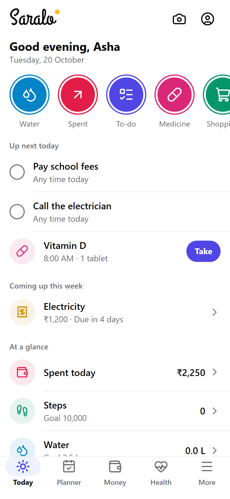
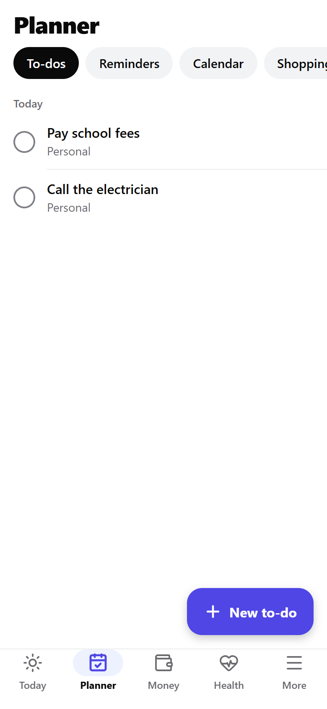
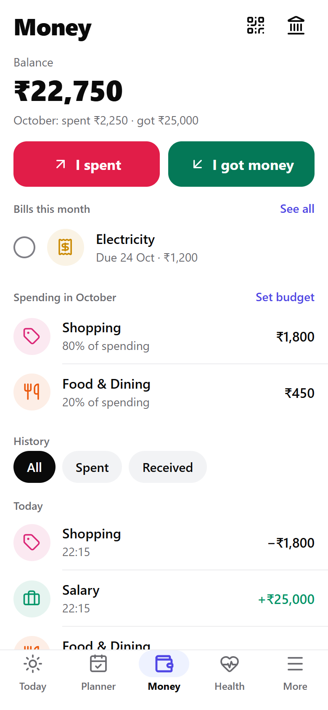
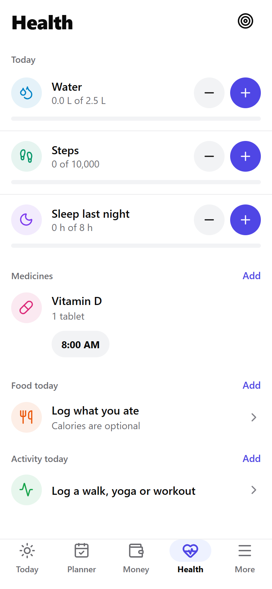
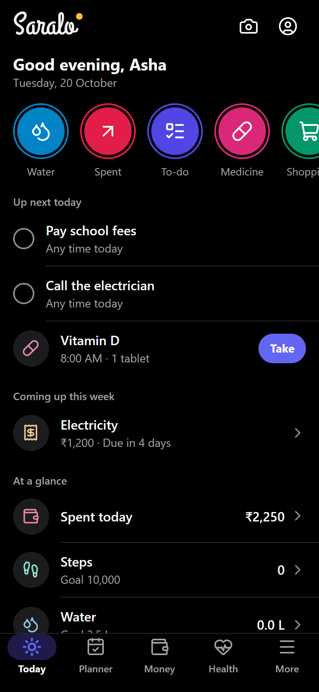
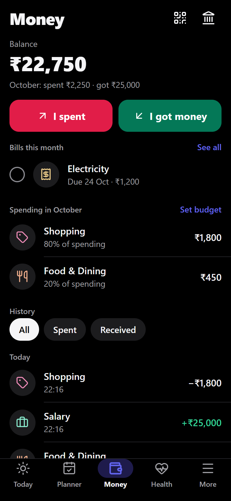

  

<h1 align="center">Saralo</h1>

A simple everyday app for people of all ages. Plan your day, track money, remember medicines and keep important documents safe, all in one place.

Everything stays on your phone. No account, no ads, no tracking.

  
  
  
  

  
  

## What it does

- **Today**: what's next today, bills and birthdays this week, spending, steps, water and weather at a glance
- **Planner**: to-dos, reminders, a calendar, a shopping list and special days
- **Money**: what you spend and get, monthly budget, bills with due-date reminders, UPI QR
- **Health**: medicine reminders, water, steps, sleep, meals and activity
- **Vault**: documents, passwords, notes and addresses behind a PIN or fingerprint
- **Outfits**: ideas for what to wear based on the weather and your clothes
- Light and dark mode, and a larger text option
- Encrypted backup and restore

## Get the app

The Android app will be available from the Releases page of this repository.

## Built with

Expo, React Native, TypeScript, React Navigation and zustand. Data is saved with expo-sqlite and encrypted with AES-GCM using a key kept in the device's secure store.

## Privacy

See [PRIVACY.md](PRIVACY.md).

## License

Copyright © 2026 Koushik Maity. All rights reserved. You can use the app, but the code, name and logo may not be copied or reused. See [LICENSE](LICENSE).
